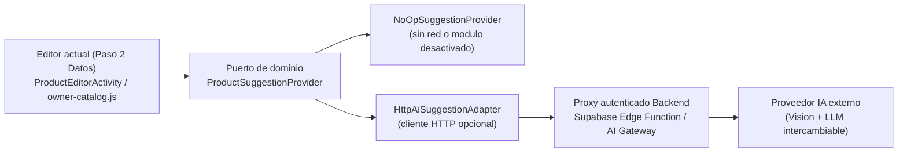

# Diseño de módulo de IA desacoplado (`RNF-MAN-02`) — ConectaSur

**SurCode / ConectaSur · Entrega 8 (Criterio C13) · Noviembre 2026**

Este documento describe cómo incorporar asistencia con Inteligencia Artificial (IA) para ayudar a las emprendedoras a redactar y clasificar productos **como un módulo desacoplado**, sin rehacer ni bloquear el flujo actual de creación de productos en Android ni en la web.

---

## 1. Principio de diseño y punto de integración actual

Hoy el catálogo de emprendedora funciona sin IA mediante editores por pasos con borradores recuperables:
- **Android:** `ProductEditorActivity` (flujo guiado de 5 pasos) y `OwnerWorkspaceRepository` (`android/app/src/main/java/cl/surcode/conectasur/`), con reducción local previa de fotografías (`LogoEncoder`, máximo `1024 px` y JPEG `<= 2 MiB`) y dictado por voz en el **Paso 2 (Datos)**.
- **Web:** `showOwnerCatalog` (`web/src/owner-catalog.js`, flujo de 4 pasos), `web/src/prepare-image.js` y `web/product-model.js`.

La regla `RNF-MAN-02` exige que la IA sea un **asistente opcional y reemplazable**:
1. El modelo de producto (`CatalogProduct` / `OwnerProduct` / `web/product-model.js`) y las tablas `public.products` en Supabase **no cambian**.
2. La sugerencia de IA actúa exclusivamente sobre el borrador en pantalla (`draft`), previa acción explícita de la emprendedora, igual que el dictado por voz actual.
3. Si el módulo IA está desactivado, sin conexión o falla, ambos editores siguen operando de forma idéntica al comportamiento actual.

---

## 2. Arquitectura desacoplada



### Componentes propuestos
1. **Puerto en dominio (`ProductSuggestionProvider`):** interfaz única en Android (`domain/`) y módulo equivalente en Web (`web/src/ai-suggestions.js`). Ninguna Activity ni pantalla web conoce SDKs ni formatos propios de un proveedor de IA.
2. **Adaptador nulo (`NoOpSuggestionProvider`):** se inyecta por defecto si no existe configuración o si el dispositivo está sin conexión. Permite compilar, probar y distribuir la app sin dependencias de IA.
3. **Adaptador HTTP (`HttpAiSuggestionAdapter`):** envía la solicitud al endpoint propio del backend con el JWT activo de Supabase del usuario y tiempo de espera acotado (por ejemplo, 10 segundos).
4. **Proxy backend (Supabase Edge Function `suggest-product-draft`):** único lugar que almacena la clave secreta del proveedor de IA en variables de entorno del servidor, verifica rol `emprendedora` activa, aplica control de cuota por tienda, construye el prompt controlado en `es-CL` y normaliza la respuesta JSON.

---

## 3. Contrato estable entre el editor y el módulo IA

### Solicitud (desde el editor hacia el puerto)
- `imageJpegBase64` (opcional): fotografía principal ya optimizada por `LogoEncoder` / `prepareImage` (no requiere nueva cámara ni subida a `Storage` para probar la sugerencia).
- `productType` (`artesania`, `ropa`, `alimento`, `planta`, `hogar`, `otro`): lista vigente de tipos del administrador.
- `existingName` y `existingDescription`: texto que la emprendedora ya escribió o dictó por voz.
- `locale`: `"es-CL"`.

### Respuesta normalizada (hacia el borrador del editor)
```json
{
  "suggestedName": "Manta tejida en telar con lana cruda",
  "suggestedDescription": "Manta artesanal tejida a mano en telar con terminaciones en flecos.",
  "suggestedCategory": "Artesanías",
  "suggestedAttributes": {
    "Material": "Lana de oveja",
    "Técnica": "Telar tradicional"
  },
  "warnings": [],
  "providerVersion": "vision-draft-v1"
}
```

El proxy descarta precios inventados (el precio y las cantidades siempre los define la emprendedora) y recorta cada campo a los mismos límites de longitud que ya validan Android y `product-model.js`.

---

## 4. Integración sin rehacer el flujo de productos

Para mantener intacto el flujo actual de creación de productos:

1. **Sin cambios en la secuencia de pasos:** la emprendedora sigue tomando o eligiendo la foto en el **Paso 1** y pasando al **Paso 2 (Datos)**.
2. **Un solo botón opcional en el Paso 2:** junto al botón existente **Decir el nombre o descripción con la voz**, se agrega **Sugerir texto desde la foto** (solo visible cuando el proveedor está configurado y hay red disponible).
3. **Aplicación revisable campo por campo:** al recibir la respuesta, el editor muestra las sugerencias antes de reemplazar lo escrito (o rellena solo campos vacíos / permite confirmar "Aplicar sugerencias" y editar cualquier palabra antes de continuar al Paso 3).
4. **Conservación intacta de borradores y cola offline:** como la sugerencia modifica el objeto `draft` en memoria antes de persistir, `OwnerWorkspaceRepository` sigue guardando el borrador cifrado por UID (`RNF-USA-04`) y sincronizando altas sin conexión (`RNF-DAT-03`) exactamente igual que hoy.
5. **Despliegue reversible por bandera (`feature flag`):** si en cualquier momento se desactiva la función en el proxy o se reemplaza `HttpAiSuggestionAdapter` por `NoOpSuggestionProvider`, no se requiere reescribir vistas, adaptadores de base de datos ni migraciones SQL.

---

## 5. Seguridad, privacidad y pruebas

- **Cero secretos en los clientes:** ninguna clave de API de IA se incluye en `BuildConfig`, el APK ni el bundle `web/dist` (`RNF-SEG-02`).
- **Autorización y control de abuso:** el proxy exige JWT válido emitido por Supabase Auth y valida en servidor que la cuenta tenga rol `emprendedora` activa y `shop_id` asignado, con límite de consultas por minuto.
- **Privacidad de datos (`RNF-PRI-01`):** la solicitud envía únicamente la imagen del producto y el tipo elegido por la usuaria; nunca envía correo, teléfono, dirección, historial de ventas ni datos de compradores. La invocación ocurre solo cuando la emprendedora pulsa el botón de sugerencia.
- **Pruebas automatizadas sin costo externo:** las pruebas unitarias del editor usan un `FakeProductSuggestionProvider` en memoria para verificar que aplicar o cancelar sugerencias conserva el borrador, respeta la longitud de los campos y no bloquea el flujo manual cuando el servicio falla o devuelve tiempo agotado.
