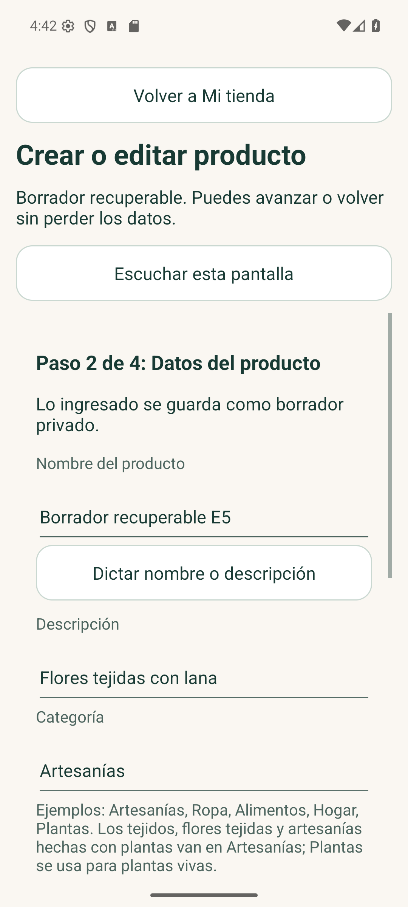
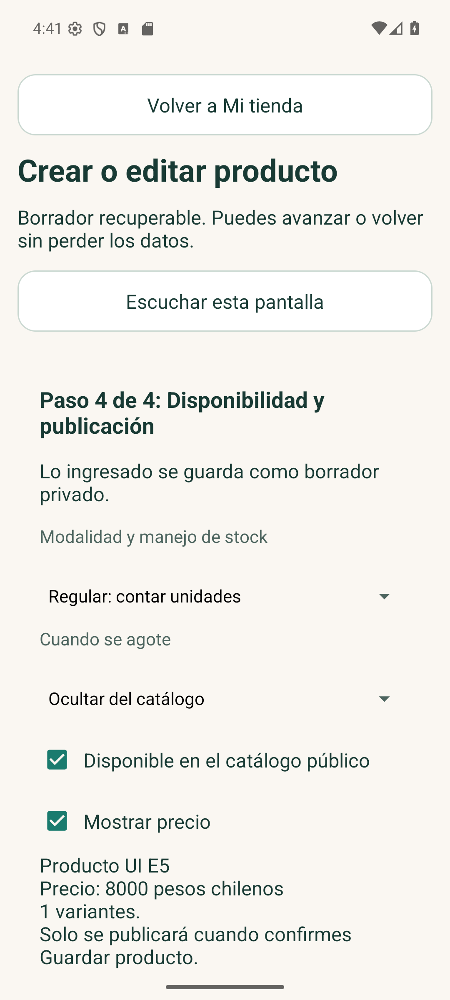
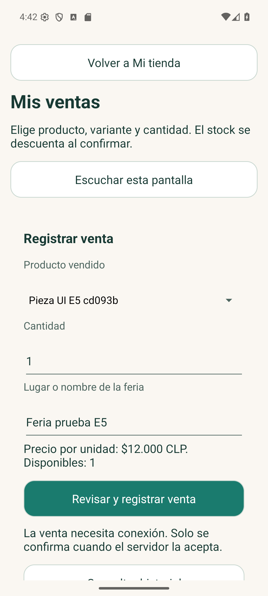

# Registro de cambios desde la propuesta y la visita

Se conserva la identidad de ConectaSur, fondo claro, verde, botones con texto y navegación sencilla. Las capturas corresponden a la aplicación real con datos ficticios. Los códigos de esta tabla organizan los comentarios comunicados por Benjamín; no sustituyen fichas de entrevista individuales.

| Observación comunicada | Cambio implementado |
|---|---|
| H01: colocar logo del emprendimiento | Mi tienda conserva selector, compresión, subida y retiro del logo; se muestra también en la ficha pública. |
| H02: cambiar tamaño de letras y botones | Los formularios de producto, variantes, ventas e historial aplican las mismas preferencias; controles de 56 dp y opción de 72 dp. |
| H03: huella opcional y sin pedirla al inicio | El inicio público no pregunta rol ni huella. La emprendedora puede activarla después de entrar; las pantallas privadas respetan el bloqueo. |
| H04: interfaz simple | Cuatro pasos de producto, un botón principal por acción, confirmación de venta y eliminación, estado de sincronización visible. |
| H05: escuchar y escribir hablando | Escuchar es voluntario. Las etiquetas ayudan a TalkBack y el dictado se invoca por separado para nombre o descripción. La lectura transforma los importes CLP a pesos chilenos. |
| H06: artesanías hechas con plantas | Se explica que fibras vegetales, tejidos y flores tejidas pertenecen a Artesanías; Planta viva tiene sus propios campos. No se reclasifican automáticamente los productos por palabras o por fotos. |
| Pérdida por interrupciones | Borrador cifrado con paso, campos, variantes y fotos; recuperación al reabrir; cola por cuenta al guardar sin red. |
| Catálogo desactualizado en feria | Venta con descuento en servidor y vista pública calculada; piezas únicas se retiran; se informa cuando la conexión impide confirmar. |

## Capturas ejecutadas

Las capturas se habilitan solo desde el instrumento de pruebas, con datos ficticios; la aplicación privada mantiene FLAG_SECURE en su ejecución normal.

## Siguiente validación con emprendedoras

Pedir que creen un producto, recuperen un borrador, cambien el tamaño de letra y registren una venta sin instrucciones del equipo. Probar huella/cámara/dictado/TalkBack en el dispositivo de cada participante. Registrar dificultades reales y sus correcciones; todavía no se atribuyen resultados a usuarias sin haber hecho esa prueba.
